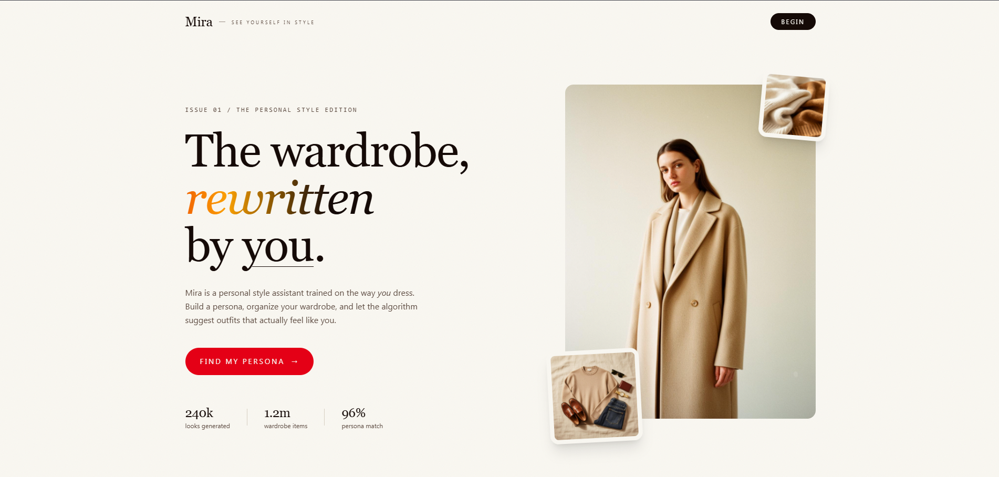
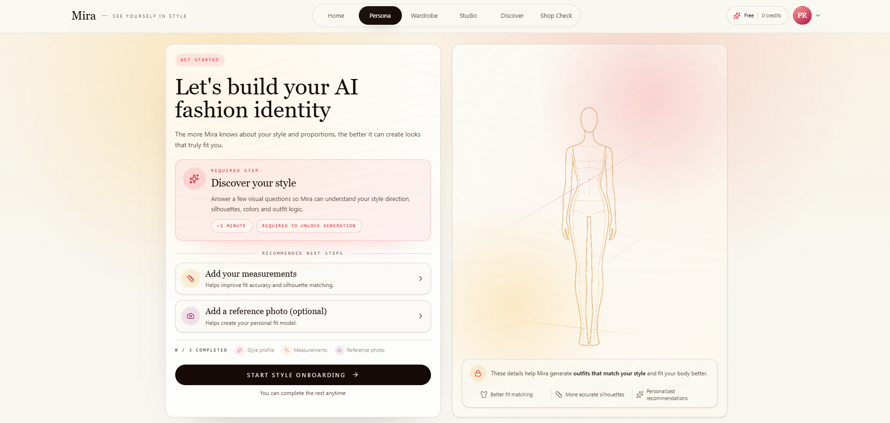
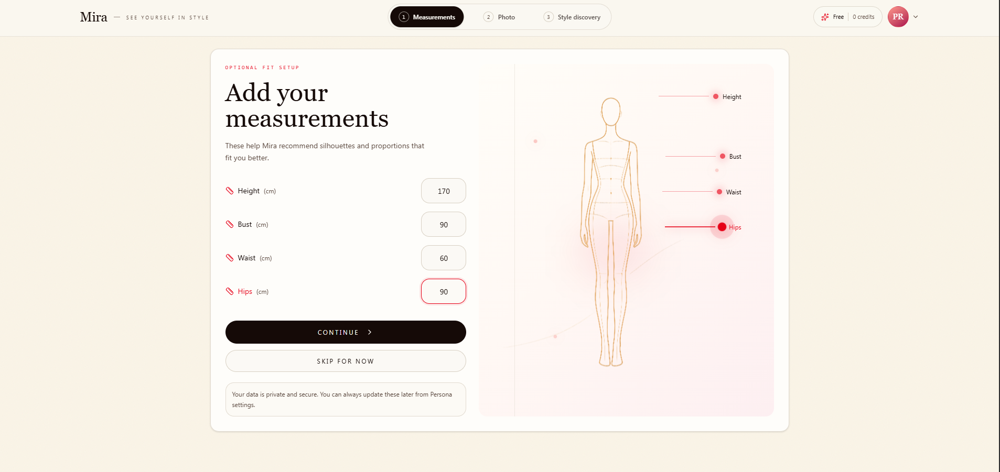
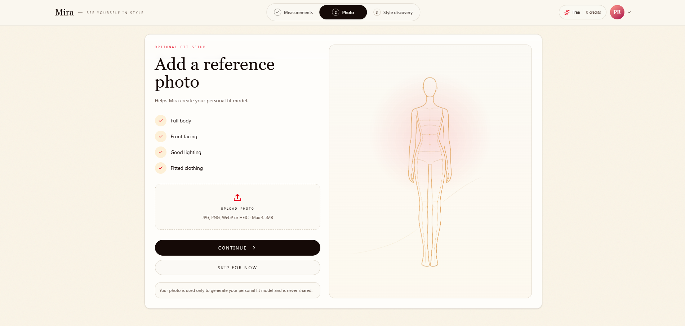
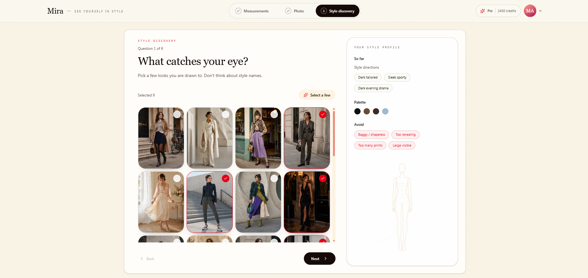
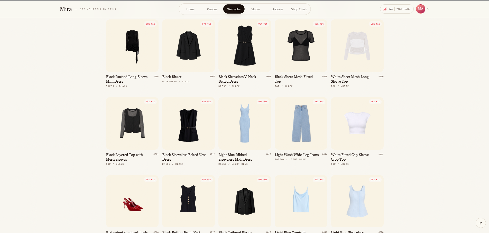
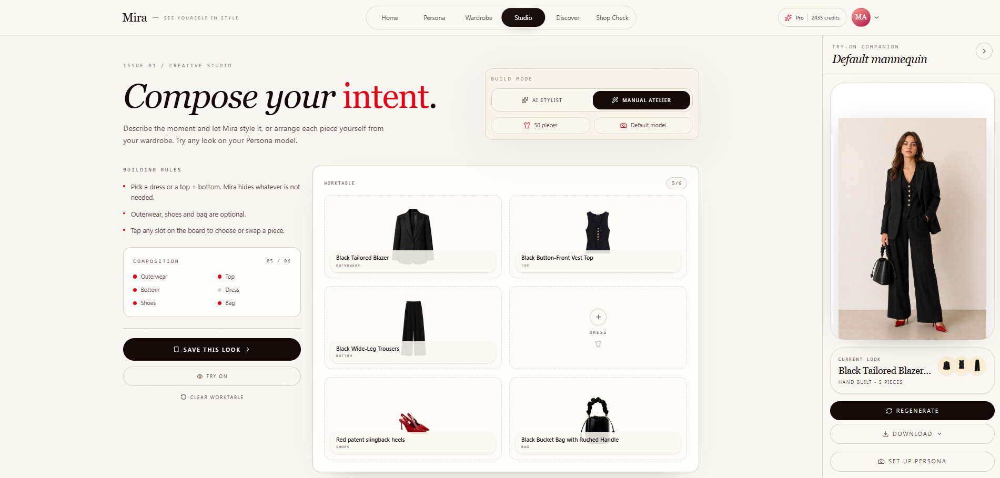
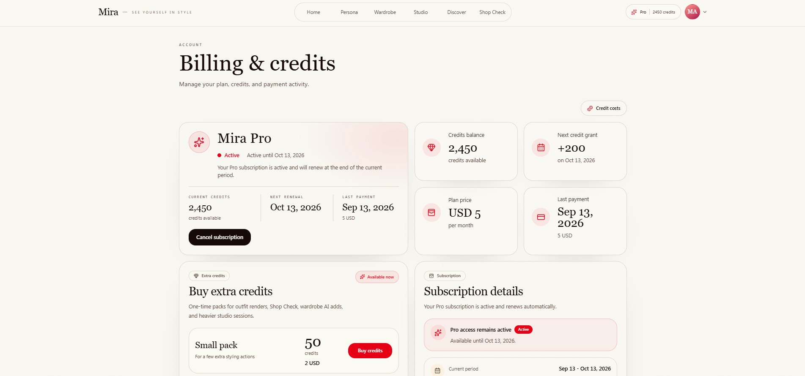

# Mira

**AI-powered personal style assistant for building a fashion persona, organizing a digital wardrobe, and creating personalized outfits.**

[**Open Live Demo →**](https://mira-fits.vercel.app)

## Overview

Mira is an end-to-end personal styling web application focused on turning a user's preferences, proportions, wardrobe, and visual references into a practical style profile and outfit-building experience.

The product combines guided onboarding, wardrobe management, personalized style discovery, outfit composition, try-on flows, and a credit-based Pro experience in one consistent interface.

## Core product flows

- **Fashion persona onboarding** — guided setup for style preferences, measurements, and an optional reference photo.
- **Style discovery** — visual preference selection used to build a style profile, palette, and styling rules.
- **Digital wardrobe** — organized garment library with category, color, and fit-related information.
- **Creative Studio** — manual outfit composition and AI-assisted styling workflows.
- **Try-on experience** — preview composed looks on a personal or default model.
- **Account & credits** — Pro plan, credit balance, renewals, and additional credit packs.
- **Discovery & Shop Check** — supporting product areas for extending styling beyond the existing wardrobe.

## Tech stack

- Next.js
- TypeScript
- Supabase
- Tailwind CSS
- shadcn/ui
- Vercel

## Product preview

### Persona setup

### Measurements

### Reference photo

### Style discovery

### Wardrobe

### Studio & try-on

### Billing & credits

## Project status

Mira is an independent portfolio product project. The live version is available for product and UI exploration.

The source code is private. This repository is a public showcase containing product information and visual previews.

---

**Designed and developed by Marina Merkotan**
